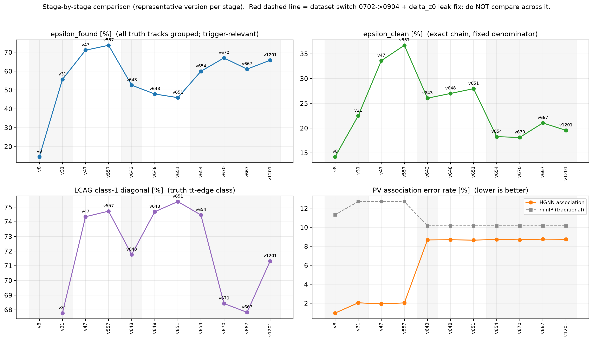

# 阶段对比：从 yukai 原始版到当前版本

> 每个阶段选代表性版本，列出所有可得的指标。
> **两条数据线之间不可直接相减**：0702 线含 `delta_z0` 顺序泄漏，0904 线已修复；数据集也不同。
> 线内（同一 N_total）的 `all_fix%` 与 `ε_found%` 可跨版本比较。



---

## 1. 总表

`N_raw` = 该版本评估时进入统计的真值链数（**随模型变**）；`all_raw%` = 旧论文口径（分母 N_raw）；
`all_fix%` = **固定分母**（0702 用 17561 / 0904 用 13255）；`ε_found%` = 径迹全聚成一个对象（允许污染）；
`ap_hardpool` / `chain_surv` = 新 benchmark（3000 事件）；PV 为关联**错误率**（越低越好）；`LCAG c1` = 真边类对角正确率。

| 阶段 | 版本 | 说明 | 线 | N_raw | 旧口径 raw% | **固定分母 all%** | **ε_found%** | ap_hardpool | chain_surv | PV HGNN / minIP | LCAG c1 |
|---|---|---|---|---|---|---|---|---|---|---|---|
| **S1 原始** | v8 | 最早版本 | 0702 | 7083 | 35.24 | 14.21 | 14.61 | — | — | 0.96 / 11.32 | — |
| **S1 论文基线** | v31 | 论文参照 | 0702 | 9764 | 40.45 | 22.49 | 55.60 | 0.5504† | 4.57† | 2.04 / 12.70 | 67.78 |
| **S2 GNN 优化** | v47 | v31→v47：图结构+特征 | 0702 | 12486 | 47.28 | 33.62 | 71.10 | 0.5500† | 2.33† | 1.93 / 12.70 | 74.34 |
| **S2 组会冠军** | v557 | 上次汇报时的最好 | 0702 | 12942 | 49.85 | 36.73 | 73.70 | 0.5471† | 1.27† | 2.03 / 12.70 | 74.72 |
| **S3 修 bug** | v643 | 首个 0904 + 种子/DOCA 全修 | 0904 | 6966 | 49.55 | 26.04 | 52.55 | 0.6470 | 32.83 | 8.66 / 10.15 | 71.76 |
| **S4 pruning** | v648 | 竞争/排他上下文 | 0904 | 6347 | 56.39 | 27.00 | 47.88 | **0.6684** | 35.77 | 8.68 / 10.15 | 74.68 |
| **S4 pruning** | v651 | 线图注意力+几何 bias | 0904 | 6089 | 60.86 | **27.96** | 45.94 | 0.6657 | 35.31 | 8.64 / 10.15 | **75.37** |
| **S5 输出** | v654 | chain_recall w=5 | 0904 | 7941 | 30.49 | 18.26 | 59.91 | 0.6591 | 52.26 | 8.71 / 10.15 | 74.46 |
| **S5 输出** | v670 | context_prune（+6.91） | 0904 | 8881 | 27.05 | 18.12 | **67.00** | — | — | 8.67 / 10.15 | 68.43 |
| **S5 输出** | v667 | edge_rank ×2（+4.99） | 0904 | 8095 | 34.45 | 21.04 | 61.07 | — | — | 8.75 / 10.15 | 67.83 |
| **S5 当前最好** | **v1201** | blend_a（**+7.63**） | 0904 | 8716 | 29.73 | 19.55 | **65.76** | — | — | 8.73 / 10.15 | 71.32 |

† 0702 线上的新 bench 是**跨数据集**评测（模型训于 0702、测于 0904），只能看趋势。

---

## 2. 逐阶段的解读

### S1 → S2：GNN 优化（0702 线内，可直接比）

| 指标 | v8 | v31 | v47 | v557 |
|---|---|---|---|---|
| 固定分母 all% | 14.21 | 22.49 | 33.62 | **36.73** |
| ε_found% | 14.61 | 55.60 | 71.10 | **73.70** |
| LCAG c1% | — | 67.78 | 74.34 | **74.72** |
| PV 错误率（HGNN） | 0.96 | 2.04 | 1.93 | 2.03 |

**结论**：GNN 侧的工作让"找到"从 55.6% 提到 **73.7%**、真边分类从 67.8% 提到 **74.7%**，固定分母整链从 22.5% 提到 **36.7%（+63% 相对）**。
**但 PV 关联没有任何改善**（1.9–2.0%，与 v31 持平）——这说明后续 PV 的"好成绩"另有来源。

### S2 → S3：换数据 + 修 bug（**不可直接比**）

所有指标"下降"（固定分母 36.73 → 26.04）是**因为换了未泄漏数据集**，不是退步。
同时期最值得注意的变化：**PV 错误率从 ~2% 跳到 8.66%，minIP 基线从 12.70% 降到 10.15%** ——
旧线上"HGNN 比传统方法好 6 倍"的印象，**主要来自数据集差异/泄漏，而不是模型**。

### S3 → S4：pruning 优化（0904 线内，可直接比）

| 指标 | v643 | v648 | v651 |
|---|---|---|---|
| 固定分母 all% | 26.04 | 27.00 | **27.96** |
| ε_found% | 52.55 | 47.88 | 45.94 |
| ap_hardpool | 0.6470 | **0.6684** | 0.6657 |
| chain_surv | 32.83 | 35.77 | 35.31 |
| LCAG c1% | 71.76 | 74.68 | **75.37** |

**结论**：pruning 侧的改动（竞争上下文、线图注意力+几何 bias）把**判别力**推到位（硬池 AP 0.647→0.668），
同时把工作点**推向"干净"端**（all% 26.0 → 28.0，但 ε_found 52.6 → 45.9）。
**这正是"干净↔找到前沿"概念的由来**：只看一个数字会得出相反结论。

### S4 → S5：输出优化（0904 线内，可直接比）

| 指标 | v651（S4 最好） | v654 | v670 | v667 | v1201（S5 最好） |
|---|---|---|---|---|---|
| 固定分母 all% | **27.96** | 18.26 | 18.12 | 21.04 | 19.55 |
| ε_found% | 45.94 | 59.91 | **67.00** | 61.07 | 65.76 |
| chain_surv | 35.31 | 52.26 | 57.74* | — | — |

\* v673 的 chain_surv 值（同批）；v670 的 3000 事件 bench 尚未出。

**结论（要点）**：
1. **输出优化把"找到"从 45.9% 推到 65.8%（+19.9pp）**，代价是"干净"从 28.0 降到 19.6。
2. 因此 **"最好的模型"取决于目标**：离线分析要 v651（干净 27.96%），触发要 v1201/v670（找到 65–67%）。
3. **按"前沿残差"判据，v1201 是当前最优（+7.63）** —— 它不是在干净轴上超过 v651，而是**在同等干净度下"找到"得更多**。
4. ⚠️ **LCAG c1 在 S5 略降**（75.4 → 67.8–71.3）—— 输出侧的改动动了 LCA 头的判别，这是后续要检查的风险点。

---

## 3. 一个必须讲清楚的"分母陷阱"（汇报时可作为方法论要点）

同一批版本，旧口径 vs 固定分母：

| 版本 | N_raw（分母） | 旧口径 raw% | 固定分母 all% | 绝对命中链数 |
|---|---|---|---|---|
| v651 | **6089** | **60.86** | 27.96 | **3706** |
| v654 | 7941 | 30.49 | 18.26 | 2421 |
| v1201 | 8716 | 29.73 | 19.55 | 2591 |

**旧口径里 v651 是 60.9%、v1201 只有 29.7%——看起来像"大退步"；但换成固定分母，两者是 27.96% vs 19.55%，差距只有 8.4pp。**
原因：剪枝放松 → 更多真值链进入统计 → 分母变大 → 百分比被压低。
**所以"某个版本翻倍"这类说法，在旧口径下有一半是分母效应。**

---

## 4. 复算

```bash
python3 make_stage_comparison.py   # -> report_figs/stage_comparison.csv
python3 make_stage_fig.py          # -> report_figs/stage_comparison.png
```
每个版本的评估文件自动匹配（同一版本可能有多个评估 tag；0702 线优先取朴素评估，0904 线优先取 `v<ver>_` 前缀）。
